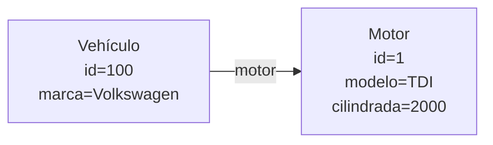
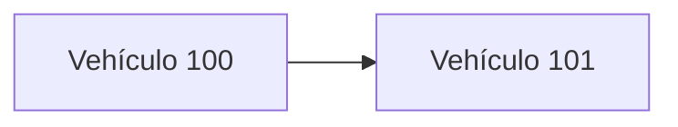
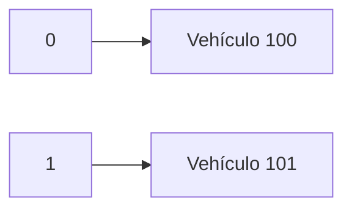
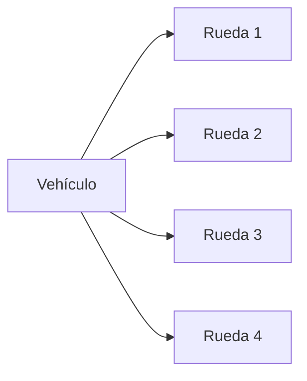

# 5. Colecciones de objetos (ArrayList)

## 5.1 Cuando un objeto no es suficiente

En las unidades anteriores hemos aprendido a crear clases y relacionarlas entre sí.

Recordemos las clases que hemos utilizado hasta ahora.

```java
public class Motor {

    private int id;
    private String modelo;
    private int cilindrada;

}
```

```java
public class Vehiculo {

    private int id;
    private String marca;

    private Motor motor;

}
```

Gracias a estas clases podemos representar un vehículo y su motor.

```java
Motor motor1 =
        new Motor(
                1,
                "TDI",
                2000);

Vehiculo coche =
        new Vehiculo(
                100,
                "Volkswagen",
                motor1);
```

La relación entre ambos objetos puede representarse de la siguiente forma:



Este diseño resulta adecuado mientras trabajemos con un único vehículo.

Sin embargo, las aplicaciones reales rara vez gestionan un único objeto.

Por ejemplo, una empresa de alquiler de vehículos puede disponer de decenas o cientos de vehículos distintos.

Surge entonces una nueva necesidad:

> ¿Cómo almacenamos varios objetos del mismo tipo?

---

## 5.2 Utilizando variables independientes

Una primera solución podría consistir en crear una variable para cada vehículo.

```java
Vehiculo vehiculo1;
Vehiculo vehiculo2;
Vehiculo vehiculo3;
Vehiculo vehiculo4;
```

Aunque esta solución funciona, pronto aparecen varios problemas.

En primer lugar, el número de variables crece continuamente.

Además, resulta difícil recorrer todos los vehículos para realizar operaciones comunes como:

- Mostrar el inventario.
- Buscar un vehículo.
- Contar los vehículos disponibles.
- Eliminar vehículos vendidos.

Este enfoque no resulta escalable.

Necesitamos una estructura capaz de almacenar múltiples objetos agrupados.

---

## 5.3 Arrays de objetos

Una posibilidad consiste en utilizar arrays.

```java
Vehiculo[] vehiculos =
        new Vehiculo[100];
```

Podemos almacenar objetos en cada posición.

```java
vehiculos[0] =
        new Vehiculo(
                100,
                "Volkswagen",
                motor1);
```

```java
vehiculos[1] =
        new Vehiculo(
                101,
                "Seat",
                motor2);
```

Los arrays ya nos permiten gestionar colecciones de objetos.

Sin embargo, presentan una limitación importante.

Su tamaño es fijo.

```java
Vehiculo[] vehiculos =
        new Vehiculo[100];
```

Una vez creado el array, no podremos almacenar más de cien vehículos.

Si la empresa adquiere nuevos vehículos será necesario crear un nuevo array de mayor tamaño.

Para resolver esta limitación Java proporciona las colecciones.

---

## 5.4 La clase ArrayList

La colección más utilizada en Java es la clase `ArrayList`.

Una lista dinámica puede crecer o reducirse durante la ejecución del programa.

Antes de utilizarla debemos importar la clase correspondiente.

```java
import java.util.ArrayList;
```

La creación de una lista vacía es muy sencilla.

```java
ArrayList<Vehiculo> vehiculos =
        new ArrayList<>();
```

Observa la expresión:

```java
<Vehiculo>
```

Indica que la colección únicamente podrá almacenar objetos de tipo `Vehiculo`.

---

## Comparación con Python

Si has trabajado previamente con Python, el concepto te resultará familiar.

Python:

```python
vehiculos = []
```

Java:

```java
ArrayList<Vehiculo> vehiculos =
        new ArrayList<>();
```

La diferencia principal es que Java exige indicar el tipo de elementos que contendrá la colección.

---

## 5.5 Añadir elementos a una colección

Una vez creada la lista podemos añadir vehículos mediante el método `add()`.

```java
vehiculos.add(
        new Vehiculo(
                100,
                "Volkswagen",
                motor1));
```

```java
vehiculos.add(
        new Vehiculo(
                101,
                "Seat",
                motor2));
```

Después de estas operaciones la colección contendrá dos vehículos.



La lista aumentará su tamaño automáticamente cada vez que añadamos nuevos elementos.

---

## 5.6 Obtener el número de elementos

El método `size()` devuelve el número de objetos almacenados.

```java
System.out.println(
        vehiculos.size());
```

Salida:

```text
2
```

---

## 5.7 Acceder a un elemento

Cada objeto ocupa una posición dentro de la colección.

Podemos acceder a ella mediante el método `get()`.

```java
Vehiculo vehiculo =
        vehiculos.get(0);
```

El valor cero hace referencia al primer elemento de la lista.



---

## 5.8 Recorrer una colección

Una de las operaciones más habituales consiste en recorrer todos los elementos almacenados.

La forma más cómoda es utilizar un bucle for-each.

```java
for(Vehiculo vehiculo : vehiculos){

    System.out.println(
            vehiculo);
}
```

En cada iteración la variable `vehiculo` contendrá uno de los elementos de la colección.

---

## 5.9 Un vehículo tiene varias ruedas

Hasta ahora hemos trabajado con una relación sencilla.

```text
Un vehículo tiene un motor.
```

Como únicamente existe un motor asociado, basta con una referencia simple.

```java
private Motor motor;
```

Sin embargo, la siguiente afirmación es diferente.

```text
Un vehículo tiene varias ruedas.
```

Ya no necesitamos almacenar un único objeto.

Necesitamos almacenar varios.

---

## La clase Rueda

Definiremos la clase `Rueda`.

```java
public class Rueda {

    private int id;
    private String marca;
    private int diametro;

}
```

Ahora podemos incorporarla al vehículo.

```java
private ArrayList<Rueda> ruedas;
```

La clase queda simplificada de la siguiente forma.

```java
public class Vehiculo {

    private int id;
    private String marca;

    private Motor motor;

    private ArrayList<Rueda> ruedas;

}
```

---

## 5.10 Inicializar la colección de ruedas

Toda colección debe crearse antes de utilizarse.

Lo habitual es hacerlo dentro del constructor.

```java
public Vehiculo(
        int id,
        String marca,
        Motor motor){

    this.id = id;
    this.marca = marca;
    this.motor = motor;

    ruedas =
            new ArrayList<>();
}
```

De este modo todos los vehículos dispondrán de una lista de ruedas vacía desde el momento de su creación.

---

## 5.11 Añadir ruedas a un vehículo

Podemos crear un método específico.

```java
public void agregarRueda(
        Rueda rueda){

    ruedas.add(rueda);

}
```

Su utilización es sencilla.

```java
vehiculo.agregarRueda(
        new Rueda(
                1,
                "Michelin",
                17));
```

```java
vehiculo.agregarRueda(
        new Rueda(
                2,
                "Michelin",
                17));
```

```java
vehiculo.agregarRueda(
        new Rueda(
                3,
                "Michelin",
                17));
```

```java
vehiculo.agregarRueda(
        new Rueda(
                4,
                "Michelin",
                17));
```

La situación puede representarse así:



Observamos una diferencia importante respecto al motor.

```java
private Motor motor;
```

representa una relación uno a uno.

Mientras que:

```java
private ArrayList<Rueda> ruedas;
```

representa una relación uno a muchos.

---

## Ideas clave

- Las colecciones permiten almacenar múltiples objetos del mismo tipo.
- `ArrayList` es la colección más utilizada en Java.
- El tamaño de un `ArrayList` puede variar durante la ejecución.
- Los elementos se añaden mediante `add()`.
- El número de elementos se obtiene mediante `size()`.
- Los elementos se recuperan mediante `get()`.
- Cuando una relación implica un único objeto utilizamos una referencia simple.
- Cuando una relación implica varios objetos utilizamos una colección.
- Un vehículo tiene un motor mediante una referencia.
- Un vehículo tiene varias ruedas mediante un `ArrayList<Rueda>`.